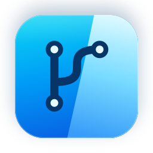
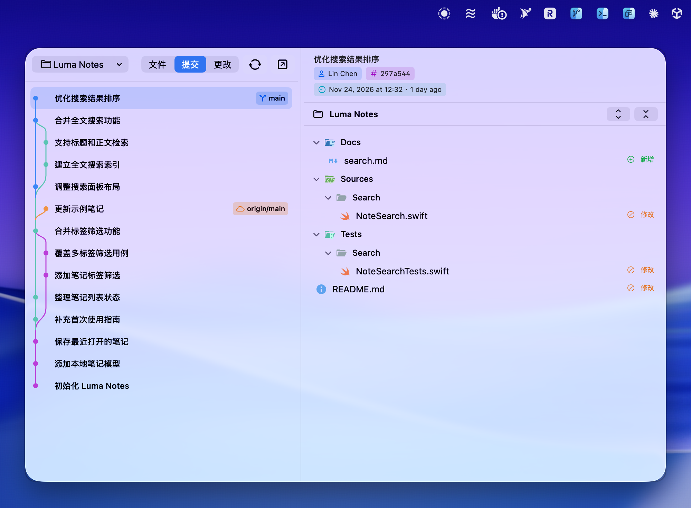

<p align="center">
  
</p>

<h1 align="center">BKGitClient</h1>

<p align="center">
  <strong>在 macOS 菜单栏浏览本地 Git 仓库</strong><br>
  回顾代码如何演变，检查手头的改动，随时翻阅项目里的代码和文档。
</p>

<p align="center">
  <sub>macOS 14+ · <a href="LICENSE">MIT License</a></sub>
</p>



<p align="center"><sub>macOS 26 上的液态玻璃面板，展示提交历史与变更文件。</sub></p>

## ✨ 功能

| 功能 | 可以做什么 |
| --- | --- |
| **提交历史** | 沿提交图查看分支与合并关系。选择一条提交，即可查看变更的文件和逐行 Diff。 |
| **工作区改动** | 浏览已暂存、未暂存和未跟踪的文件。同一文件同时有已暂存和未暂存的改动时，可以切换查看两种 Diff。 |
| **项目文件** | 沿文件树阅读带语法高亮的只读源码。Markdown 支持预览、源码切换和目录跳转。 |
| **远程仓库** | Fetch 当前分支的上游更新。若已配置 GitHub 远端，可直接在浏览器中打开仓库。 |

## 🖱️ 菜单栏用法

启动后点击菜单栏图标，选择 **添加本地仓库…**，再选中仓库目录或其中的任意子目录。打开仓库后，在 **文件**、**提交** 和 **更改** 三个视图之间切换。

添加多个仓库后，长按菜单栏图标，移到最近使用的项目上松开，即可切换。按 `Esc` 收起面板。

## 🛠️ 本地开发

应用使用 Swift、SwiftUI 和 AppKit，构建需要 **Xcode 26 或更高版本**。

```sh
git clone https://github.com/binbinku/BKGitClient.git
cd BKGitClient
open BKGitClient.xcodeproj
```

在 Xcode 选择 `BKGitClient` 方案和 `My Mac`，按 `⌘R` 运行，按 `⌘U` 运行测试。查看器资源随项目提供。修改 [Monaco 查看器源码](MonacoSource) 后，在该目录运行 `npm ci` 和 `npm run build` 重新生成资源。

## 许可证

项目自有代码采用 [MIT License](LICENSE)。[Monaco 查看器及 Markdown 依赖](BKGitClient/MonacoViewer) 与 [Material Icon Theme](BKGitClient/MaterialIconTheme) 保留各自的许可证与声明。
